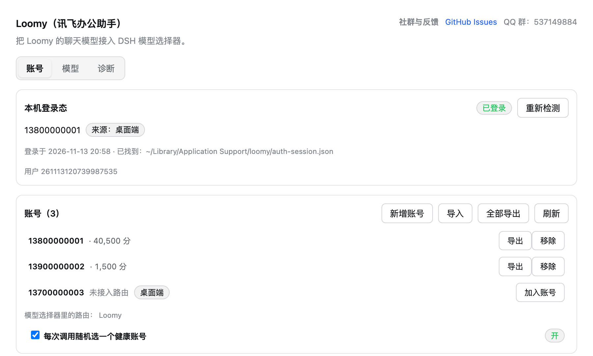
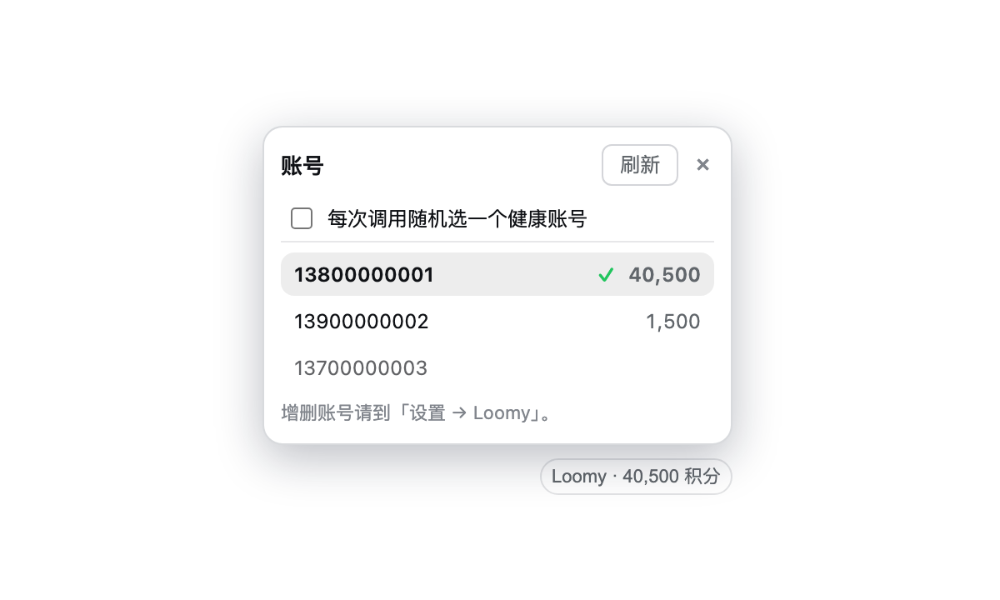
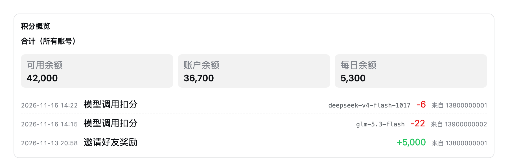

# dsh-connect-loomy

Brings the chat models you are already signed in to in **Loomy** (iFlytek's office assistant) into **DSH**'s model picker — install it, pick Loomy, and talk to it like any other model. It also shows how many points you have left.

> It only reads the sign-in that the Loomy desktop app already stored on this machine. The plugin provides no accounts, shares no credentials and bypasses no billing: every call spends points from your own account.

## Screenshots

| Accounts | Account drawer in the composer | Credits |
|---|---|---|
|  |  |  |

## Before you start, check two things

1. **The Loomy desktop app is installed and you have signed in once**
   (the plugin reads the sign-in it saved; the app does not need to keep running)
2. **DSH is installed** (0.2.2-rc.1 or newer)

## Install: three steps

Open a terminal and paste the commands **one block at a time**.

**Step 1 — download and build**

```bash
cd ~/Documents
git clone https://github.com/diudiu62/dsh-connect-loomy.git
cd dsh-connect-loomy
pnpm install
pnpm build
```

**Step 2 — install into DSH**

```bash
dsh plugin --profile web add link:$PWD
```

> Use `link:`, not `file:`. `file:` **copies** the plugin into DSH, so later
> rebuilds never reach it.

**Step 3 — restart DSH**

Quit DSH and start it again. Afterwards:

- **Settings → Loomy** shows a card → installed
- the **model picker** shows a **Loomy** group → connected

## Using it

### 1. Check you are signed in

Open **Settings → Loomy**. You should see **Signed in** and your phone number.

If not: sign in through the Loomy desktop app, then press **Re-check** here.

### 2. Pick a model and chat

In the **model picker** under the composer, choose **Loomy** and then a model.

### 3. Keep an eye on your points

Next to the model picker there is a small badge:

```
Loomy · 40,500 pts
```

That is how much **the current account** has left. Press it to see the details.

### 4. More than one account?

Add as many Loomy accounts as you like and switch between them:

1. Settings → Loomy → **New account** (sign in with an SMS code) or **Import** (paste an export from another machine)
2. Back in the composer, **click the badge** to open the account list
3. Click an account to spend that one

The drawer also has a switch: **pick a healthy account at random for each call**.

- On: every call picks an account that still has points, and one that stops working is skipped automatically
- Off: always the account you selected

### 5. Moving an account to another machine

In the settings card press **Export** on an account's row, copy the text, and press **Import** on the other machine. No SMS code needed.

> The export **is the credential itself** — treat it like a password. Do not share it or commit it.

## Troubleshooting

**No Loomy card in settings?**
Restart DSH (not just the browser). If it still is not there, check step 2 with `dsh plugin --profile web list dsh-connect-loomy`.

**No Loomy group in the model picker?**
You are not signed in yet. Sign in through Loomy, then press **Re-check** in the card.

**"No usable Loomy app configuration"?**
The Loomy desktop app is not installed on this machine (or lives somewhere unusual). Install it, then press **Re-check**.

**"Sign-in has expired"?**
Sign in through the Loomy desktop app again, then press **Re-check**.

**The badge is missing?**
It only appears while the current conversation is on a Loomy model.

**Switched account but the number did not change?**
Press **Refresh** in the drawer; otherwise the host answers from a 60-second cache.

**Points show as unavailable?**
That account's sign-in expired. Sign in again — the other accounts are unaffected.

## Stuck? Ask the community

- **QQ group**: `537149884` (fastest; ask right after installing)
- **Bugs and feature requests**: [GitHub Issues](https://github.com/diudiu62/dsh-connect-loomy/issues)

Before posting, press **Copy report** on the card's diagnostics tab and paste that text along: it carries versions, paths and the upstream wording, but no session token, phone number or user id.

The same entry is pinned to the **top-right corner of the settings card**, next to the title. Contacts live in one place — [`src/shared/community.ts`](src/shared/community.ts). The QQ group is filled in; WeChat and email are still placeholders (`[WECHAT_ID]`). Placeholders are hidden, and a real value appears automatically in the card, in `--help` and in these docs.

## Learn more

- **Technical details**: [plugin contract](docs/dsh-plugin-contract.md) · [measured upstream contract](docs/loomy-upstream.md) · [verification report](docs/verification-report.md)
- **CLI**: `node lib/bin.js status --json` (account and balance), `node lib/bin.js doctor --json` (network and sign-in diagnostics)
- **Configuration**: cache lifetimes and endpoints live in the DSH profile config
- **Not supported yet**: daily check-in (Loomy has no such endpoint), rotating across models, transferring points to others

## Uninstall

```bash
dsh plugin --profile web remove dsh-connect-loomy
```

Then restart DSH.

## License

MIT
