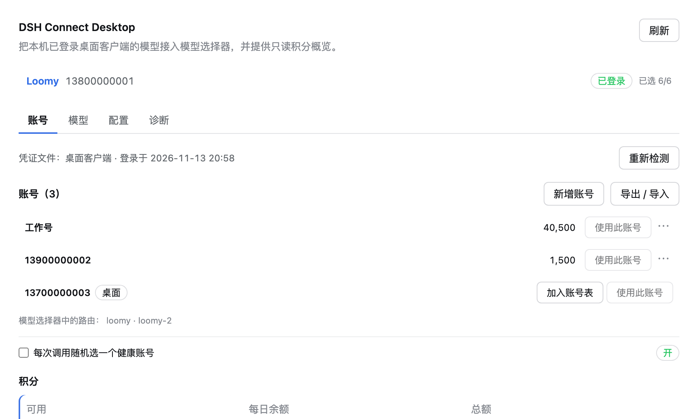
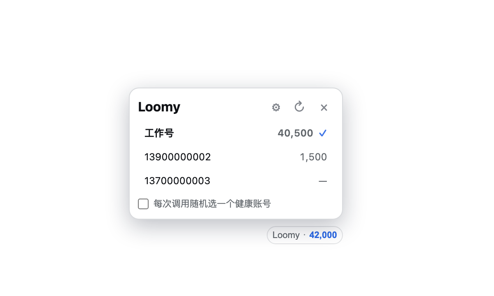
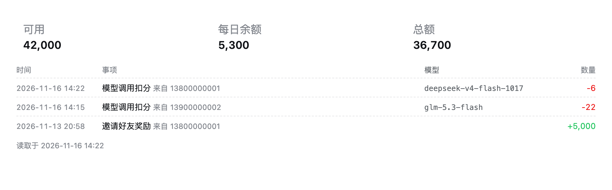
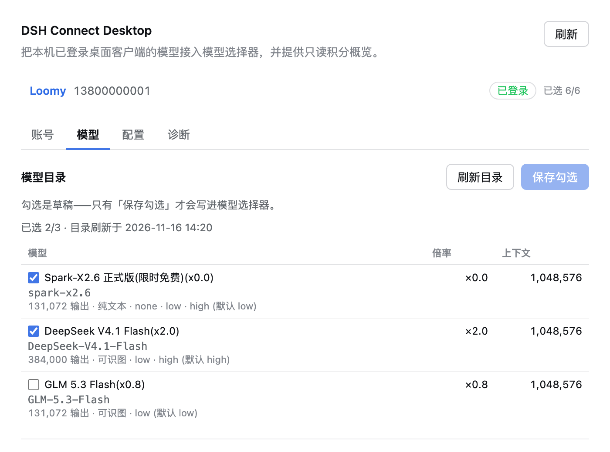
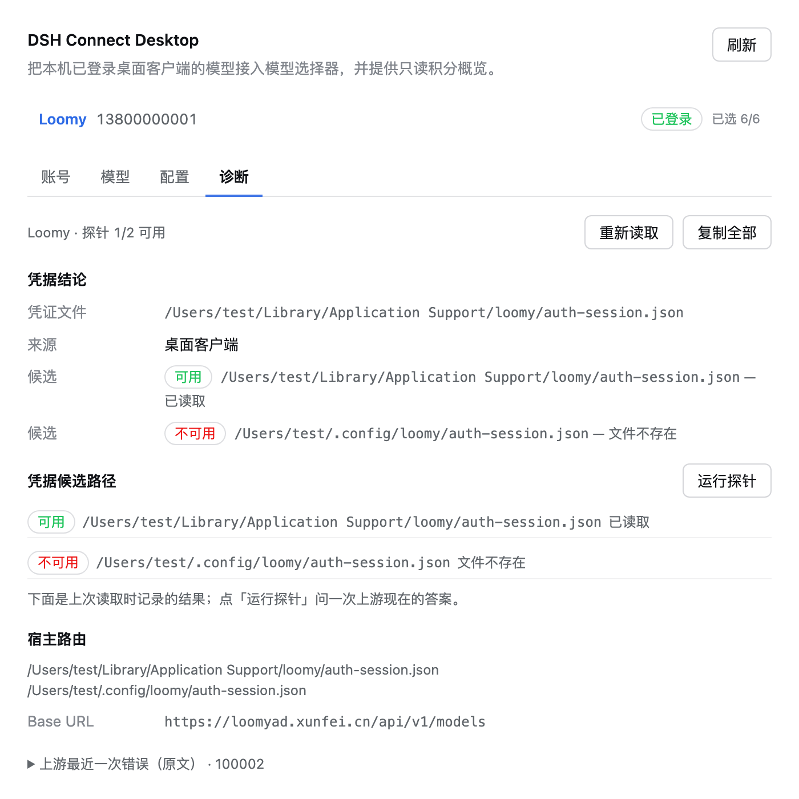
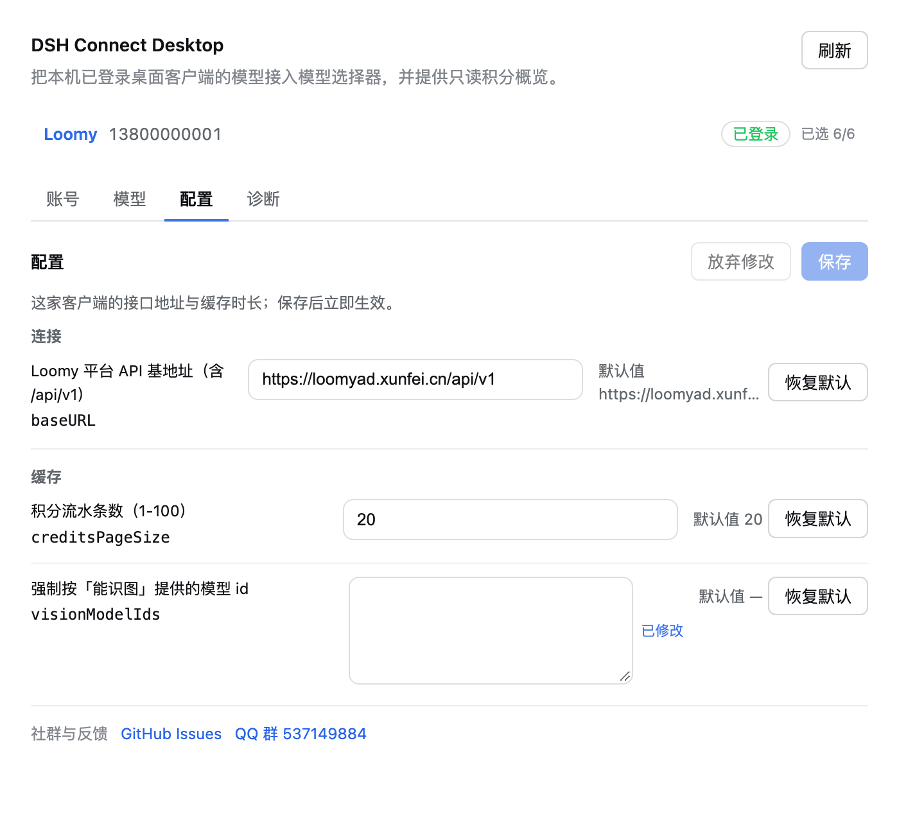

> **This plugin has been renamed to `dsh-connect-desktop`** (0.2.0). One plugin, several desktop
> clients: currently **Loomy (iFlytek)** and **SenseTime Raccoon**. A third-party plugin with the
> same old name exists on the market; use the canonical repository address when in doubt.

# DSH Connect Desktop

Brings the chat models you are already signed in to on your **desktop clients** into **DSH**'s
model picker — install it, pick a client, and talk to it like any other model. It also shows how
many points you have left.

> It only reads the sign-in that a desktop app already stored on this machine. The plugin provides
> no accounts, shares no credentials and bypasses no billing: every call spends points from your own
> account.

## Supported clients

| Client | Group in the picker | Notes |
| --- | --- | --- |
| **Loomy** (iFlytek office assistant) | `Loomy` | multi-account behind **one** picker group, export/import |
| **SenseTime Raccoon** | `商汤小浣熊` | appears only when its client is installed and signed in |

Both share one settings card, one composer badge and one set of panels — adding a third client is a
protocol module, not a new UI (see [`docs/vendor-onboarding.md`](https://github.com/diudiu62/dsh-connect-loomy/blob/HEAD/docs/vendor-onboarding.md)).

## Screenshots

| Accounts | Account drawer in the composer | Credits |
|---|---|---|

| Accounts | Account drawer in the composer | Credits |
|---|---|---|
|  |  |  |
| Models | Diagnostics | Config |
|  |  |  |

## Before you start, check two things

1. **At least one desktop client is installed and you have signed in once**
   (the plugin reads the sign-in it saved; the app does not need to keep running)
2. **DSH is installed** (0.2.2-rc.1 or newer)

## Install: three steps

Open a terminal and paste the commands **one block at a time**.

**Step 1 — download and build**

```bash
cd ~/Documents
git clone https://github.com/diudiu62/dsh-connect-loomy.git
cd dsh-connect-loomy
pnpm install
pnpm build
```

> The repository keeps its original name; the **package** is `dsh-connect-desktop`. `git clone` also
> works through GitHub's redirect if the repository is renamed later.

**Step 2 — install into DSH**

```bash
dsh plugin --profile web add link:$PWD
```

> Use `link:`, not `file:`. `file:` **copies** the plugin into DSH, so later
> rebuilds never reach it.

**Step 3 — restart DSH**

Quit DSH and start it again. Afterwards:

- **Settings → Desktop models** shows a card → installed
- the **model picker** shows one group per detected client → connected

### Upgrading from 0.2.x or earlier

0.3.0 made "a vendor" a contract, and dropped every compatibility shim. Accounts, settings and
routes moved:

```bash
dsh plugin --profile web remove dsh-connect-loomy
dsh plugin --profile web add link:$PWD
```

- **Sign in again.** Data now lives under `~/.dsh/storages/dsh-connect-desktop/<vendor>/`; the old
  directory is not read (deliberate: no dual-read, no migration code).
- **Configuration is namespaced** per vendor: `vendors: { loomy: { baseURL }, raccoon: { baseURL } }`.
  Missing fields fall back to the vendor's declared defaults.
- **Routes and the CSRF header changed**: `/plugins/dsh-connect-desktop/<vendor>/…` and a single
  `x-dsh-connect-csrf`. The old per-vendor header names are gone.
- Chat history is unaffected: model identity (`provider='loomy'` / `'raccoon'`) is frozen on purpose.

## Using it

### 1. Check you are signed in

Open **Settings → Desktop models**. Each detected client shows **Signed in** with its account.

If a client is missing: sign in through that desktop app, then press **Re-check** in the card
(or run the client again). You do not need to restart DSH.

### 2. Pick a model and chat

In the **model picker** under the composer, choose the client's group and then a model.

A client that is not installed and signed in **does not appear** in the picker at all — an empty
group would only make every call fail.

### 3. Keep an eye on your points

Next to the model picker there is a small badge:

```
Loomy · 40,500
```

That is how much **the current account** has left. Press it to open the account drawer.

### 4. More than one account?

Add as many accounts as you like and switch between them:

1. Settings → Desktop models → **New account** (sign in with an SMS code) or **Import** (paste an
   export from another machine)
2. In the composer, **click the badge** to open the account list
3. Click an account to spend that one

Accounts never multiply the picker: there is exactly one `Loomy` group, no matter how many accounts
you add. Which account pays is decided per call, not by the group you picked.

The drawer also has a switch: **pick a healthy account at random for each call**.

- On: every call picks an account that still has points, and one that stops working is skipped
  automatically
- Off: always the account you selected

A desktop-owned sign-in shows **Desktop** and cannot be renamed or removed here — it belongs to the
client. Use **Adopt** if you want it to become a stored account the pool can spend from (Loomy only).

### 5. Moving an account to another machine

In the settings card press **Export** on an account's row, copy the text, and press **Import** on the
other machine. No SMS code needed.

> The export **is the credential itself** — treat it like a password. Do not share it or commit it.

## Troubleshooting

**No card in settings?**
Restart DSH (not just the browser). If it still is not there, check step 2 with
`dsh plugin --profile web list dsh-connect-desktop`.

**No group in the model picker?**
That client is not signed in yet (Raccoon also needs its client installed). Sign in, then press
**Re-check** in the card.

**"No usable … app configuration"?**
The desktop app is not installed on this machine (or lives somewhere unusual). Install it, then
press **Re-check**.

**"Sign-in has expired"?**
Sign in through the desktop app again, then press **Re-check**. The plugin never refreshes tokens
on its own.

**The badge is missing?**
It only appears while the current conversation is on a model from one of these clients.

**Switched account but the number did not change?**
Press **Refresh** in the drawer; otherwise the host answers from a 60-second cache.

**Points show as unavailable?**
That account's sign-in expired. Sign in again — the other accounts are unaffected.

**The whole diagnostics tab says "unavailable"?**
That client declares no diagnostics, or the running host predates this client build. Restart DSH.

## Stuck? Ask the community

- **QQ group**: `537149884` (fastest; ask right after installing)
- **Bugs and feature requests**: [GitHub Issues](https://github.com/diudiu62/dsh-connect-loomy/issues)

Before posting, open the diagnostics tab and press **Copy report**: it carries versions, paths and
the upstream wording, but never the session token.

The same entry is pinned to the **top-right corner of the settings card**, next to the title.
Contacts live in one place — [`src/shared/community.ts`](src/shared/community.ts). The QQ group is
filled in; WeChat and email are still placeholders (`[WECHAT_ID]`). Placeholders are hidden, and a
real value appears automatically in the card, in `--help` and in these docs.

## Learn more

- **Adding a provider**: [vendor onboarding](https://github.com/diudiu62/dsh-connect-loomy/blob/HEAD/docs/vendor-onboarding.md)
- **Architecture and why it is shaped this way**:
  [vendor capability architecture](https://github.com/diudiu62/dsh-connect-loomy/blob/HEAD/docs/product/vendor-capability-architecture.md)
- **Host API contract**: [plugin contract](https://github.com/diudiu62/dsh-connect-loomy/blob/HEAD/docs/dsh-plugin-contract.md)
- **Measured upstream contracts**: [Loomy](https://github.com/diudiu62/dsh-connect-loomy/blob/HEAD/docs/loomy-upstream.md) · [Raccoon](https://github.com/diudiu62/dsh-connect-loomy/blob/HEAD/docs/raccoon-upstream.md)
- **CLI**: `node lib/bin.js status --json` and `node lib/bin.js doctor --json`
  (`--vendor loomy|raccoon` to narrow it down)

## Uninstall

```bash
dsh plugin --profile web remove dsh-connect-desktop
```

Then restart DSH.

## License

MIT