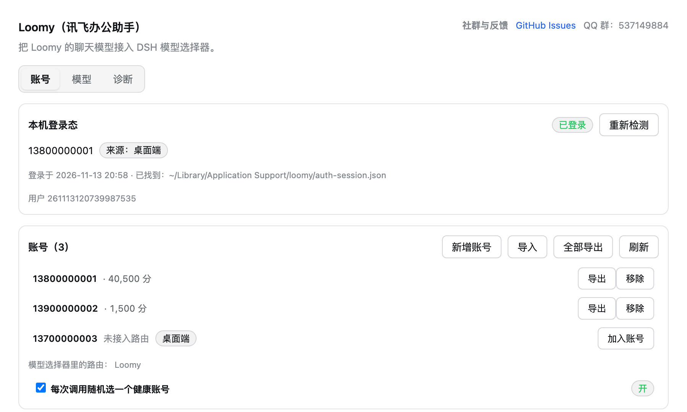
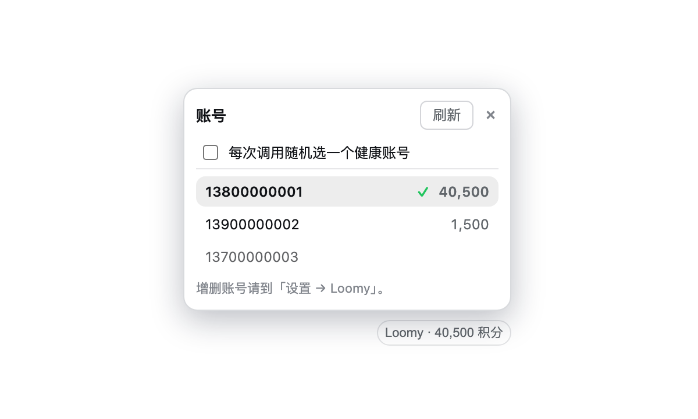
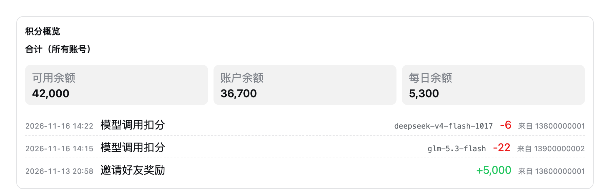

# dsh-connect-loomy

把 **Loomy（讯飞办公助手）** 里已经登录的聊天模型，接到 **DSH** 的模型选择器里——装完就能像用其它模型一样直接对话，还能随时看到自己还剩多少积分。

> 只读取你在本机 Loomy 客户端已经有的登录状态。插件不提供账号、不共享凭据、不绕过计费：每次对话花的都是你自己账号的积分。

## 截图

| 账号管理 | 输入框旁的账号抽屉 | 积分概览 |
|---|---|---|
|  |  |  |

## 装之前，先确认两件事

1. **电脑上装了 Loomy 桌面端，并且登录过一次**
   （插件读的是它保存的登录状态；登录一次就行，之后不用一直开着）
2. **电脑上装了 DSH**（版本 0.2.2-rc.1 或更高）

## 安装：三步

打开「终端」，把下面的命令**一段一段**粘贴执行。

**第 1 步：下载并构建**

```bash
cd ~/Documents
git clone https://github.com/diudiu62/dsh-connect-loomy.git
cd dsh-connect-loomy
pnpm install
pnpm build
```

**第 2 步：装进 DSH**

```bash
dsh plugin --profile web add link:$PWD
```

> 注意这里必须用 `link:`，不要用 `file:`。
> `file:` 会把插件**复制**一份到 DSH 里，以后你更新代码就不生效了。

**第 3 步：重启 DSH**

关掉 DSH 再打开。重启后：

- 打开 **设置 → Loomy**，能看到一张设置卡片，说明装好了
- 打开**模型选择器**，能看到 **Loomy** 一组模型，说明接上了

## 怎么用

### 1. 先确认是登录状态

打开 **设置 → Loomy**，最上面显示 **已登录** 和你的手机号就对了。

如果显示未登录：打开 Loomy 桌面端点一下登录，然后回到这里点 **重新检测**。

### 2. 选模型开始聊

在对话框下面的**模型选择器**里选 **Loomy**，再选具体模型，就能像平常一样对话了。

### 3. 随时看积分

模型选择器旁边有个小胶囊，长这样：

```
Loomy · 40,500 积分
```

数字就是**当前账号还剩多少积分**。每次对话会扣一点，点一下胶囊可以看明细。

### 4. 想用多个账号？

如果你有多个 Loomy 账号（比如工作和个人的），可以都加进来，随时切换：

1. 设置 → Loomy → 点 **新增账号**，用手机验证码登录；或者点**导入**，粘贴另一台电脑导出的账号
2. 回到对话框，**点胶囊**，弹出账号列表
3. 点哪个账号，就用哪个账号的积分

抽屉里还有一个开关：**每次调用随机选一个健康账号**。

- 打开：每次对话自动挑一个还有积分的账号，某个账号失效了会自动跳过它
- 关闭：固定用你在列表里点选的那个账号

### 5. 想把账号搬到另一台电脑？

在设置卡片里点某个账号那行的 **导出**，把内容复制走；到新电脑上点 **导入** 粘进去，就不用再收验证码了。

> 导出的内容**就是登录凭证本身**，等于密码。别发到群里、别提交到 GitHub。

## 常见问题

**看不到 Loomy 设置卡片？**
重启 DSH（不是刷新浏览器）。还不行就检查第 2 步装成功了没有：`dsh plugin --profile web list`。

**模型选择器里没有 Loomy？**
说明还没登录。打开 Loomy 桌面端登录一次，然后到设置卡片点 **重新检测**。

**提示「没有找到可用的 Loomy 应用配置」？**
这台电脑没装 Loomy 桌面端，或者装的位置不常见。装上之后点 **重新检测**。

**提示「登录态已失效」？**
在 Loomy 桌面端重新登录一次，然后到设置卡片点 **重新检测**。

**胶囊不显示？**
只有当前会话选中了 Loomy 模型时才会出现。切到其它模型它就隐藏了。

**切换账号后数字没变？**
点抽屉里的 **刷新** 强制重新读一次（平时为了省请求有 60 秒缓存）。

**积分显示「不可用」？**
那个账号的登录状态过期了，重新登录即可；其它账号不受影响。

## 卡住了？来群里问

- **QQ 群**：`537149884`（最快，装上就能问）
- **提问题 / 提需求**：[GitHub Issues](https://github.com/diudiu62/dsh-connect-loomy/issues)

提问前先点设置卡片诊断页的 **复制诊断**，把那段文本一起贴上——里面有版本、路径和上游原话，但不含登录凭据、手机号和用户 id。

这一栏也常驻在设置卡片的**右上角**（标题旁），不用滚到底部就能点。联系方式只维护在 [`src/shared/community.ts`](src/shared/community.ts) 一处：群号已经填好，微信/邮箱还是占位符（`[WECHAT_ID]` 这种），占位符不会显示，填上真实值就会自动出现在卡片、`--help` 和这份文档里。

## 想了解更多

- **技术细节**：[插件契约](docs/dsh-plugin-contract.md) · [上游接口实测记录](docs/loomy-upstream.md) · [验证报告](docs/verification-report.md)
- **命令行**：`node lib/bin.js status --json`（看账号与余额）、`node lib/bin.js doctor --json`（网络与登录排查）
- **配置项**：缓存时长、接口地址等可在 DSH 的 profile 配置里改，见 [安装与配置说明](docs/dsh-plugin-contract.md)
- **现在还不支持**：自动每日签到（Loomy 没有这个接口）、账号自动轮换到不同模型、把积分转给别人

## 卸载

```bash
dsh plugin --profile web remove dsh-connect-loomy
```

然后重启 DSH。

## 许可

MIT
