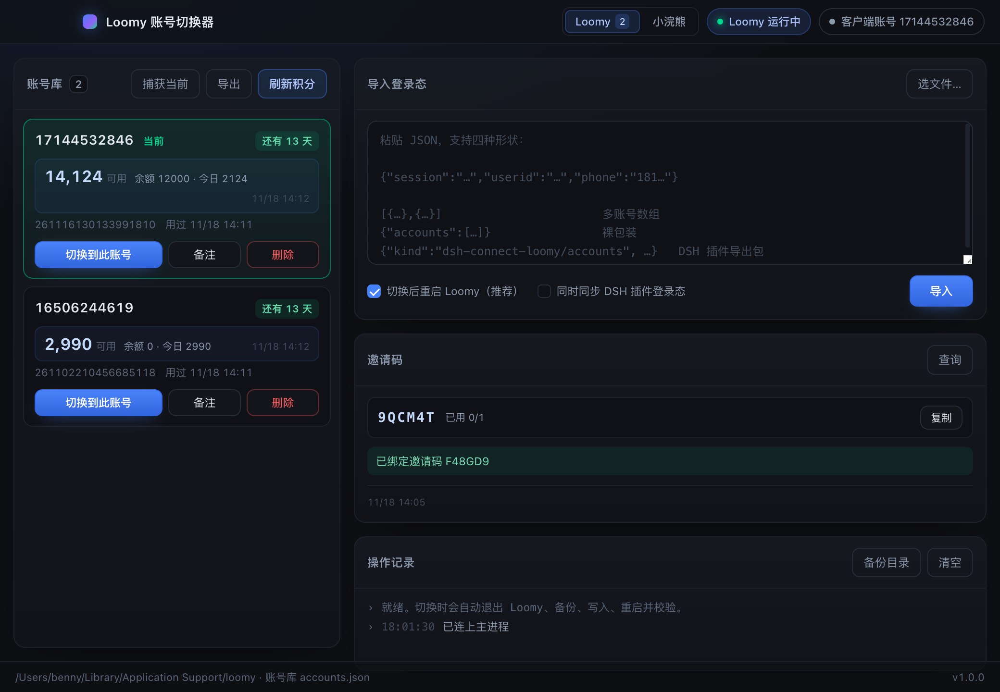

# 账号切换器（Loomy + 小浣熊）

一个 macOS 桌面小工具：把 JSON 登录态**导入客户端**，之后在图形界面里随时切换账号、查看积分。不用再手改文件、不用关掉终端。

支持两个客户端，顶部 tab 一键切换：

| 平台 | 登录态位置 | 认证方式 | 有效期 |
| --- | --- | --- | --- |
| **Loomy**（讯飞办公助手） | `Local Storage/leveldb` 的 `loomy-auth-session` | 裸 `token` 头 | 14 天 |
| **小浣熊**（商汤） | `agent/config/auth.json` 的 `access_token` | `Authorization: Bearer` | 30 天（JWT `exp`） |



## 两个平台的机制差异

### Loomy：改 leveldb，不是改 auth-session.json

Loomy 的登录态有两处，而且**渲染进程那份才是源头**：

| 位置 | 角色 |
| --- | --- |
| `~/Library/Application Support/loomy/Local Storage/leveldb/*.log` 里的 `loomy-auth-session` | **真正的登录态**。渲染进程从这里读，启动后通过 `electronAPI.auth.setSession()` 反向写回主进程。 |
| `~/Library/Application Support/loomy/auth-session.json` | 主进程镜像。**单独改它没用**——下次启动会被渲染进程覆盖回去。 |

所以本工具的切换流程是：退出 Loomy → 备份 → 往 leveldb 日志追加一条合法 WriteBatch → 同步镜像 → 重启 → 回读校验。

> 打包版 Loomy 移除了 `--remote-debugging-port`（见 `electron/utils/remote-debugging.js` 的 `sanitizePackagedRemoteDebuggingSwitches`），所以没法用 CDP 在线改，只能离线写 leveldb。这也是为什么要先退出客户端。

## 用法

1. 双击 `Loomy 账号切换器.app`
2. 右边粘贴 JSON，或点「选文件…」

   ```json
   { "session": "09b4e53c68fb44008afc5bd8bedfb92d", "userid": "261116130133991810", "phone": "17144532846" }
   ```

   支持四种形状：单条、`[{…},{…}]` 数组、`{"accounts":[…]}`、以及 DSH 插件导出的 `{"kind":"dsh-connect-loomy/accounts", …}` 整包。
3. 点「导入」，账号进了左边的账号库
4. 点「切换到此账号」——它会自动退出、备份、写入、重启、校验

选项：

- **切换后重启 Loomy**：默认勾选。取消后只写文件，下次你手动启动才生效（测试时方便）。
- **同时同步 DSH 插件登录态**：顺手把同一份凭证写到 `~/.dsh/storages/dsh-connect-loomy/auth-session.json`，`dsh-connect-loomy` 插件立刻用新账号。

其他按钮：

- **捕获当前**：把客户端正在用的账号存进账号库（做成备份密码本的第一步）
- **导出**：导出成 DSH 插件同格式的 bundle，可以拿到别的机器导入
- **备注**：给账号起名（"工作号" / "个人号"）
- **备份目录**：每次切换前的完整快照都在 `~/.loomy-account-switcher/backups/`

### 小浣熊：一个明文 JSON，直接改就行

反编译 `商汤小浣熊.app` 得到的结论比 Loomy 简单得多：

- 登录态是 `<userData>/agent/config/auth.json`，内容 `{access_token, office_identity}`，权限 0600；
- `access_token` 是 IAM 签发的 JWT（`iss: xiaohuanxiong.com/iam`），**`exp` 里直接有过期时间**，不用推算；
- 主进程启动时 `readDesktopAuthState()` 就读它，没有 leveldb、没有 safeStorage 加密；
- 渲染进程启动会重新拉 `user_info` + `setting_info`，所以**改完重启客户端就生效**，不用清缓存。

实测：回写同结构文件后启动客户端，登录态保持、token 未被覆盖。写入时会保留文件里的其它字段（未来版本新增的配置不会丢）。

## 积分与邀请码

### 批量刷新积分

点账号库右上角的 **「刷新积分」**，会并发（4 路）查询**当前平台**账号库里每个账号的剩余积分（不会跨平台混刷——Loomy 的 token 打小浣熊的接口只会 401），结果直接显示在卡片上并写入磁盘——下次打开就能看到上次刷到的数字，不用再等一次请求。

卡片上是「一个主数字 + 一行平台说明」：

```
Loomy：  14,124 可用   余额 12,000 · 今日 2,124      11/18 14:05
小浣熊：  9,873 可用   今日提问 0/20                  11/18 18:10
```

| 平台 | 主数字来源 | 说明行 |
| --- | --- | --- |
| Loomy | `availableBalance` | `balance` / `dailyBalance` 双桶 |
| 小浣熊 | `available_points` | 今日提问 `daily_question_count/limit` |

三个数字都来自上游原值，不做四则运算。**查询失败时不会显示 0**——那看起来像"没钱了"，实际是查不到，所以卡片上会红字写「积分读取失败」加原因。

因为用的是账号库里缓存的 session 直接打上游，**不需要切账号、不需要重启客户端**就能看到所有账号的余额。

接口分别是：

- Loomy：`GET /api/v1/points/records`（`token` 头）
- 小浣熊：`GET /api/web/office/v3/setting_info`（`Bearer`，客户端自己的设置接口）

### 邀请码（仅 Loomy）

> 小浣熊**没有个人邀请码接口**——反编译确认只有团队/项目邀请（`/projects/:id/invitations`）和"邀请好友"营销页。所以切到小浣熊时这一栏会明确写着不适用、按钮禁用，而不是留一个点不动的按钮。

右侧「邀请码」面板点 **「查询」**，显示当前账号名下自己的邀请码和绑定状态：

- 自己的码：`9QCM4T  已用 0/1` + 一键复制（复制的是纯码，方便发给别人）
- 绑定状态：`已绑定邀请码 F48GD9` 或 `尚未绑定任何人的邀请码`
- 没绑过时会出现「绑定邀请码…」按钮，点了要二次确认——**一个账号通常只能绑一次，绑错不能改**

> baseURL 说明：`points-config.json` 里写的 `ossptest.voicecloud.cn/loomy/integration` 对本 session 会直接回 `100002 登录已失效`（实测）。真正可用的是 `loomyad.xunfei.cn/api/v1`，与 DSH 插件的 `DEFAULT_BASE_URL` 一致。

## 账号缓存（重要）

导入过的账号会**永久留在账号库里**，关掉应用、重启电脑都还在，之后打开就能直接点「切换到此账号」，不用再粘 JSON。

- 存放位置：`~/.loomy-account-switcher/accounts.json`（权限 `0600`）
- 状态栏右下角显示的 `账号库 accounts.json` 就是它
- 每个账号可以点「备注」起名（"工作号" / "个人号"）

### 每条账号都带过期倒计时

上游签发 session 时给的是 **14 天**有效期，缓存下来不等于永久可用。界面上每条卡片右上角直接标出来：

| 徽标 | 含义 |
| --- | --- |
| 还有 N 天（绿） | 正常可用 |
| N 小时后过期（黄） | 不足 48 小时，该准备换新 JSON 了 |
| 已过期（红） | 切过去客户端会停在登录页；按钮变成「已过期 · 仍要切换」 |

倒计时从**你拿到这份 session 的时刻**算起（导入时记录 `credentialedAt`）。重复导入同一份 session 不会续期——那本来就是同一张票，上游不会因为你又贴了一次而延长。

### 切换失败会记在账号上

切过去之后如果校验不通过（比如这张票其实已经失效），失败原因会钉在那张卡片上，红底显示：

```
上次切换失败：镜像仍是 189****2700（session 可能已失效）
```

下次切换成功后自动清除。这样你打开应用就知道该换哪一条，而不是对着一个卡在登录页的客户端猜。

## 安全边界

- 账号库 `accounts.json` 是 **0600**，位于 `~/.account-switcher/`（早期版本在 `~/.loomy-account-switcher/`，首次启动自动迁移）（刻意不放在 Electron 的 userData 里——那目录混着 Cache/GPUCache 一堆缓存，备份时容易连云缓存一起拷）
- **手机号与 userid 明文显示**：这是你自己的本机工具，账号本来就归你，遮成 `165****9364` / `165****9340` 只会让你分不清是哪一条（尤其几个号前七位相同时）。界面上的号码、userid 都是完整值。
- **唯一脱敏的是 session**：它是可直接消费的凭据（谁拿到谁能花积分），而手机号/userid 只是标识符。所以渲染进程拿不到 session，`vault.list()` 只回一个末 6 位用于人工比对。
- 开启 `contextIsolation`，关闭 `nodeIntegration`，CSP 里 `default-src 'none'`
- 每次切换前自动备份整个 `Local Storage` 目录，只保留最近 20 份
- 满打满算一句话：**这个 app 里的 `accounts.json` 就是凭证本身**，别丢进 git、别放共享盘

## 从源码跑

```bash
cd apps/loomy-switcher
npm install          # 需要网络拉依赖
node scripts/make-icon.mjs   # 生成图标（可选，仓库里已有）
npm start            # 开发模式启动
npm test             # 43 个单测：leveldb 编解码、回放、边界、保险箱、过期、两个平台的 API、JWT
node scripts/pack.mjs        # 打包成 dist/*.app
node scripts/ui-test.mjs "dist/Loomy 账号切换器-darwin-arm64/Loomy 账号切换器.app"  # 12 项界面冒烟
```

打包用的是 `@electron/packager`，复用 `~/Library/Caches/electron` 里已下载的 Electron zip，不会重新联网拉 100MB+。

## 已知限制

- **仅 macOS**。路径、`osascript`、`pkill`、`iconutil` 都是 macOS 专用。
- 小浣熊的登录态是明文 JWT，且**不区分工作/个人**（`office_identity` 会一起保留）。
- **session 有 14 天寿命**（上游签发时 `expire: 14*24*3600`）。过期后客户端会回登录页，那时用本工具导入新 JSON 即可。界面上的倒计时就是为了让你提前知道。
- 切换期间 Loomy 会重启，未发送的输入框内容会丢。
- 不做短信登录、不做自动续期：本工具只搬运你已经有的登录态。

## 目录

```
src/main/loomy-store.js   客户端读写：路径发现、进程控制、leveldb 编解码、切换流程
src/main/vault.js         账号库：多平台、去重、备注、导入导出、积分/邀请码缓存、0600 落盘
src/main/platform-api.js  Loomy API：积分、邀请码（裸 token 认证）
src/main/targets/         平台实现：loomy.js（leveldb）、raccoon.js（明文 JWT）
src/main/main.js          Electron 主进程 + IPC
src/main/preload.cjs      contextBridge，只暴露 12 个方法
src/renderer/             界面（原生 DOM，无框架）
test/                     单测
scripts/make-icon.mjs     图标生成（手写 PNG 编码 + iconutil）
scripts/pack.mjs          打包
scripts/ui-test.mjs       CDP 驱动的界面冒烟测试
```
